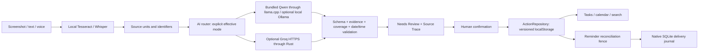

# Architecture

## Data flow and responsibilities

The router does not replace extraction. `RoutedExtractionService` reuses the prompt, semantic validator, OCR checkpoints, coverage checks, date/time rules, evidence validation and review contracts. A schema-compliant model response can still be wrong. All extracted actions start in Needs Review; undated/ambiguous sources must not acquire invented dates.

## Components and why they exist

| Component                             | Responsibility and rationale                                                                                                                  |
| ------------------------------------- | --------------------------------------------------------------------------------------------------------------------------------------------- |
| React / TypeScript / Zod              | Accessible mounted capture/review UI, typed contracts and runtime validation                                                                  |
| Tauri v2 / Rust                       | Desktop lifecycle, bounded native file/process operations, credentials, HTTPS and reminder integration with narrow IPC permissions            |
| Tesseract + eng/ceb/tgl data          | Local screenshot OCR with region IDs and bounding boxes for Source Trace                                                                      |
| CPAL / Symphonia / Rubato             | Local capture, supported-codec decoding, bounded audio conversion to Whisper input                                                            |
| Whisper Small / whisper.cpp           | Local multilingual transcription with segment IDs/timestamps; no remote audio upload                                                          |
| Qwen3-4B Q4_K_M / llama.cpp           | Bundled CPU extraction without a hosted backend; significant RAM/latency constraints remain                                                   |
| Optional Ollama                       | Existing loopback-only, user-enabled local-model adapter                                                                                      |
| Optional Groq                         | BYOK hosted extraction for users choosing online processing; native fixed HTTPS endpoint, strict output projection, local semantic validation |
| LocalStorageRepository                | Versioned task authority behind an async repository; serialized writes, schema checks and recovery without silently replacing corrupt data    |
| ReminderSafeRepository / Rust journal | Durable pause/reconcile fence around task changes; SQLite journals scheduling/delivery, not canonical tasks                                   |

## Code boundaries

- `src/app/services.ts`: dependency composition; default Local mode, explicit cloud routing, mock only for browser development and labelled samples.
- `src/services/ai/`: provider contracts, registry, local-device scoring, router and shared processing-mode coordinator. Cloud candidates do not require local inference RAM/GPU. Local-provider fallback stays local.
- `src/services/extraction/`: prompt construction, source-unit correspondence, structured parsing, semantic validation and at most one bounded repair.
- `src/features/`: capture, source inspection, mounted review editors and Settings. Save intent distinguishes draft, confirmation and ordinary update; completion is emitted after the existing persistence/reminder path resolves.
- `src/repositories/`: task persistence/migration and reminder fences. Snapshot version remains 1; additions use safe defaults and legacy compatibility checks.
- `src-tauri/src/`: fixed native providers, private OCR/audio jobs, process lifetime control, assets, privacy-safe opt-in diagnostics and reliability worker.
- `scripts/`: build-time pinned asset preparation, license collection, acceptance harnesses and distribution tooling. These do not run as an online model downloader in installed applications.

## Local and online boundaries

Local mode uses Tauri IPC and the private `127.0.0.1` llama-server with an ephemeral bearer credential, or explicitly enabled loopback Ollama. Voice transcription and screenshot OCR stay local even in Groq mode. Groq receives minimum source-unit text/identifiers and necessary context, not original screenshot/audio bytes, preview URLs, filenames or saved task collections.

The Rust Groq client fixes the endpoint/model, disables redirects, validates TLS, bounds request/response sizes and checks credentials, consent, effective mode and quota before attempts. Discovery is local-only. Connectivity is a passive OS hint; explicit verification/request outcomes supply provider reachability. A durable recovery latch prevents restoration or unrelated settings updates from silently resuming uploads. Captures snapshot their mode; cancellation/late-response guards prevent cross-provider resubmission.

Credentials are held in native OS credential storage where supported, with session-only fallback. Status never returns the key. Application-profile namespaces isolate acceptance stores from production. Main-window capabilities permit only named operations; the webview has no direct remote network, arbitrary shell or filesystem capability.

## Storage, lifecycle and limits

Task previews/transcripts, task JSON, delivery journal and exports are **unencrypted**. Backups exclude native credentials and Groq usage/consent metadata, but include private source/task data. Browser and native profiles do not share storage. Separate browser tabs do not provide transactional cross-tab writes. Import/restore, encryption, autostart and primary SQLite task storage are not complete.

Local jobs use UUIDs, cancellation flags, bounded native subprocesses and retained preprocessing checkpoints. Unix OCR/audio jobs are private and cleaned; Windows ACL and actual installer acceptance remain platform gates. Native sidecars receive argument vectors, never shell-interpolated source text. Speech and local extraction share a gate to avoid concurrently loading two models.

On Linux, reusable llama.cpp servers are spawned by a permanent launcher thread. `PR_SET_PDEATHSIG` follows the creating thread; a retiring Tokio request worker must not kill the shared model. Short subprocesses stay with their waiting caller. The OS still kills the persistent child when TaskLens exits or crashes; regression tests cover both worker retirement and abrupt parent termination.

Native reminders are opt-in. Task mutation pauses scheduling durably, persists tasks, then reconciles. Reconciliation failure leaves delivery paused and shows a distinct warning. OS submission is not visibility or acknowledgment; interrupted delivery claims are not blindly retried. See [native reliability](docs/NATIVE_RELIABILITY.md).

## Build identity and honest evidence

`models.json` pins formats, hashes, byte counts, runtime revisions and license texts. Startup verifies assets without loading inference models; readiness means verified assets/runnable programs, not demonstrated extraction accuracy. Installed Local mode needs no network download. Build scripts stamp commit/dirty identity and production builds reject forced mock providers/public credential-like environment variables.

Historical evaluation files remain dated evidence of their original prompt/runtime. They do not verify the current candidate. [The audit](RELEASE_AUDIT.md) separates static checks, mocks, browser checks, native acceptance, real inference, installers and platform gaps. Source-pinned builds are reproducible inputs; bit-for-bit binary reproducibility is not claimed without independent rebuild comparison.
