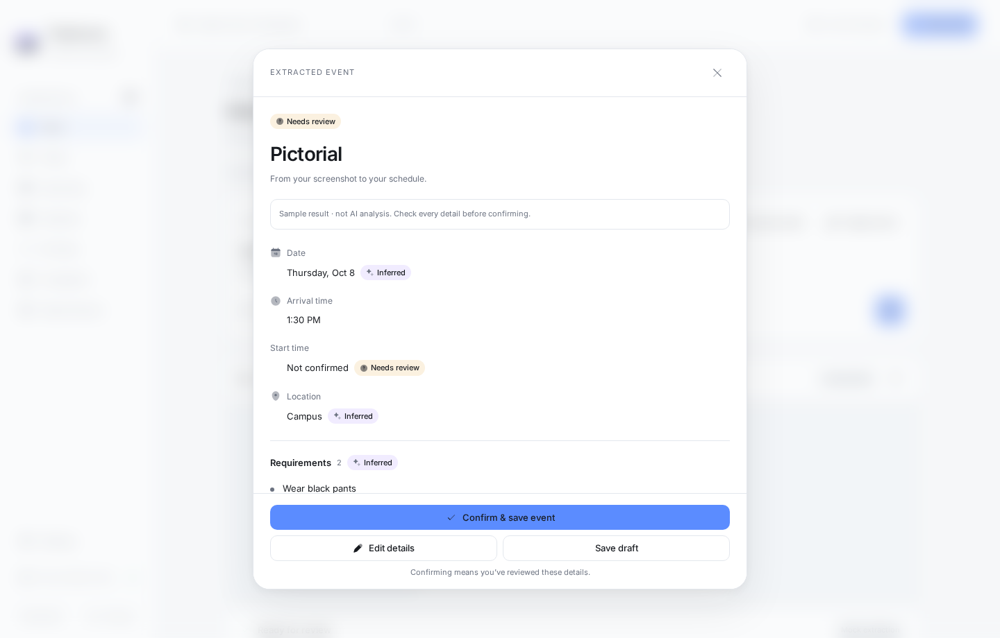
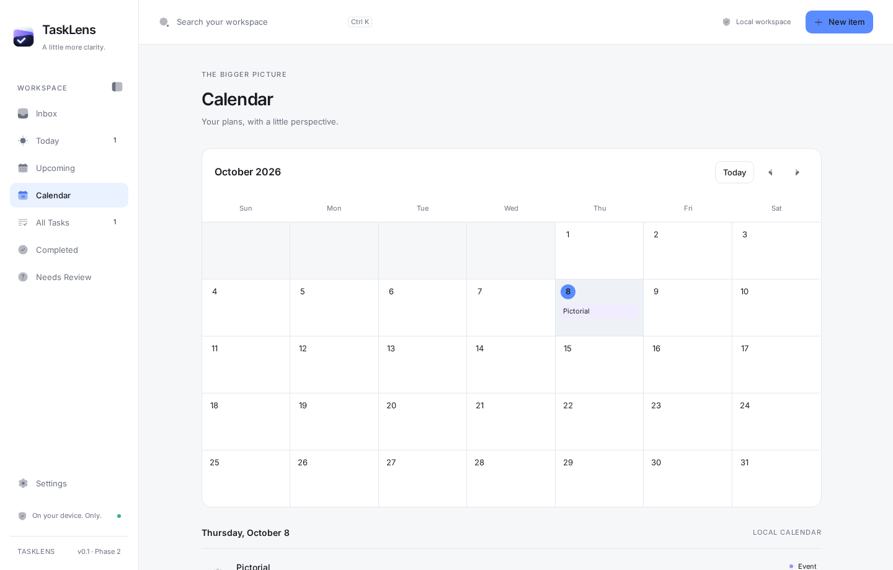
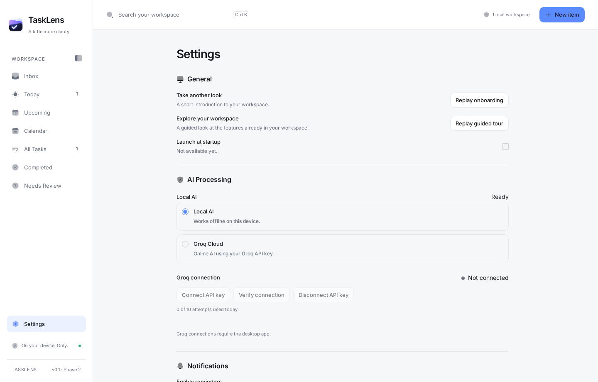

# TaskLens

**Turn information into action. Privately.**

TaskLens turns screenshots, typed text and locally transcribed voice into editable tasks, events and deadlines. **Capture → Extract → Review → Confirm → Save → Workspace.** Source Trace helps users compare suggestions with their source before confirming them.


_Current application UI rendered in Chromium with a fresh synthetic demo profile. These screenshots show the interface and labelled sample workflow; they are not native inference or installer evidence._

**Release status: pre-release candidate, not an approved production release.** Read [the release audit](RELEASE_AUDIT.md), [verification gates](RELEASE_CHECKLIST.md) and [security audit](SECURITY_AUDIT.md). A working sample is not evidence that real AI inference succeeded.

## The TaskLens application

TaskLens brings capture, review and planning into one desktop workspace:

- **Capture:** paste or drop screenshots, type information, record a voice note, or import audio.
- **Choose processing:** use Local AI or explicitly connect Groq Cloud with your own key. Guided setup explains the privacy boundary before online extraction.
- **Review before saving:** check source evidence, edit extracted details, resolve uncertain fields, and review multiple activities individually.
- **Plan locally:** use Today, Upcoming, Calendar, All Tasks, Needs Review and workspace search. Native reminder delivery requires explicit activation.
- **Make the workspace yours:** collapse the sidebar, use keyboard shortcuts, and replay the 12-step guided tour from Settings.

## Processing and privacy

- **Local AI (default):** Tesseract OCR, multilingual Whisper Small and Qwen3-4B through llama.cpp run on this computer. Prepared all-in-one desktop packages include the weights, OCR data and native runtimes; the installed application does not download models.
- **Groq Cloud (optional):** bring your own Groq API key, explicitly select online processing and agree to the disclosure. Rust sends recognized source text, identifiers and extraction context to Groq. Original screenshots/audio stay local, and voice transcription stays local. [Connect Groq](docs/GROQ_BYOK.md).
- A local error never silently uploads a source. Connectivity loss retains input and requires an explicit retry/Cloud reactivation. Extraction results require human review.
- Tasks, thumbnails, transcripts and JSON backups are **not encrypted**. Task storage is versioned webview localStorage. SQLite is a native reminder **delivery journal**, not task storage. No login backend, sync service, analytics or telemetry is included.

## Run from source

Use Node **22.23.2** (minimum 22.12), npm, Rust **1.99.0**, and the [Tauri prerequisites](https://v2.tauri.app/start/prerequisites/) for your OS.

```sh
npm ci
npm run dev
```

Open http://127.0.0.1:1420. Browser development and **Try a sample screenshot** use labelled deterministic mock extraction. They are useful for UI development, not native/AI acceptance.

For an actual desktop window, install compiler/CMake and native dependencies, then prepare assets once:

```sh
npm run prepare:models
npm run build:runtimes
npm run prepare:notices
npm run tauri dev
```

Fedora prerequisites and Windows build requirements are in [LOCAL_AI.md](LOCAL_AI.md). Preparation downloads pinned upstream assets; later installed Local-mode inference works offline with loopback enabled. Qwen3-4B needs several GB of available memory and can be slow on CPU. Missing resources or insufficient memory do not prevent manual task management.

## Supported targets and evidence

| Platform     | Intended target                                    | Acceptance                                                                        |
| ------------ | -------------------------------------------------- | --------------------------------------------------------------------------------- |
| Fedora Linux | x86_64, RPM/AppImage                               | Native checks available; consult the dated matrix, not a blanket production claim |
| Windows      | x86_64, offline Inno Setup installer with WebView2 | Current Windows installer/runtime acceptance pending                              |
| macOS        | Apple Silicon build recipes                        | Experimental; current runtime/signing acceptance not established                  |

No signed public release or approved demonstration video is linked yet. See the [one-minute native demo checklist](DEMO_CHECKLIST.md). A video link will be added only after a real desktop recording is supplied or approved.

## Everyday workflow

1. Browse, drop or paste a PNG/JPG/WEBP screenshot (up to 10 MB), enter text, record voice or import supported audio.
2. Follow real processing stages; cancellation preserves recoverable source data.
3. Review dates, times, requirements, locations, missing information and Source Trace. Multiple activities remain separate review items.
4. Confirm & Save waits for persistence, then dismisses or advances review. Save Draft keeps an item in Needs Review.
5. Find saved items in Today, Upcoming, Calendar, All Tasks or search. Create a task manually with New item at any time.

Ctrl/Cmd K opens search. Ctrl+Shift+Space toggles the persistent sidebar; icon navigation has labels/tooltips. Settings contains AI mode/key management, notifications, appearance, data export and expandable advanced diagnostics. Native reminders require separate activation; OS submission does not prove banner visibility. Autostart, encrypted storage and backup import are unfinished.

## Inside TaskLens

<details>
<summary>Review a captured announcement</summary>



The built-in sample is clearly marked “not AI analysis.” Extracted suggestions stay in Needs Review until the user confirms them.

</details>

<details>
<summary>See a saved event in Calendar</summary>



The example uses the synthetic October 8, 2026 announcement, with the demo clock fixed to that date.

</details>

<details>
<summary>Manage processing and the Groq connection in Settings</summary>



Browser previews disable native credential actions. The Tauri desktop application provides the native connection and verification controls. No key is shown or stored in these images.

</details>

Screenshot provenance: [capture notes](docs/screenshots/README.md). [Latest main CI](https://github.com/clarkkkkkkk/tasklens-desktopApp/actions).

## Checks and packaging

```sh
npm run check
npm run format:check
npm run docs:check
npm test
npm run test:assets
npm run test:release
npx playwright install chromium
npm run test:e2e
npm run build
cargo fmt --manifest-path src-tauri/Cargo.toml -- --check
cargo test --locked --manifest-path src-tauri/Cargo.toml
npm audit
cargo audit --file src-tauri/Cargo.lock
# Clean, committed, equipped native checkout only:
npm run release:desktop
```

Rust/native checks require prepared resources. Real AI and credential-store tests are explicitly opt-in; ordinary CI uses mocks and no real Groq key. See [CONTRIBUTING.md](CONTRIBUTING.md) and [release instructions](docs/RELEASING.md).

The two model weights total **2,984,882,223 bytes** before OCR/runtime resources. Installers can exceed GitHub's per-asset limit. [Distribution instructions](docs/RELEASING.md) describe checksum-verified parts of the **complete installer**; this is not a runtime model downloader.

## Project and contribution guide

[Architecture](ARCHITECTURE.md) · [Technology choices](TECH_STACK.md) · [Local AI](LOCAL_AI.md) · [Voice](VOICE_CAPTURE.md) · [Groq](docs/GROQ_BYOK.md) · [Historical evaluation evidence](docs/evaluation/reliability-v10-full.md) · [Changelog](CHANGELOG.md) · [Contributing](CONTRIBUTING.md) · [Code of conduct](CODE_OF_CONDUCT.md) · [Security](SECURITY.md)

TaskLens source is [MIT licensed](LICENSE). Models, icons, fonts and native dependencies retain their own licenses; see [THIRD_PARTY_NOTICES.md](THIRD_PARTY_NOTICES.md) and bundled full notices. The original `TaskLens.png` logo is preserved.
