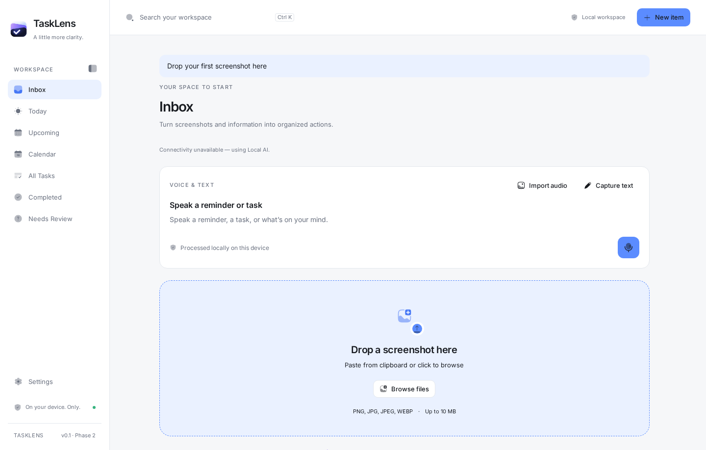

# TaskLens

**Turn information into action. Privately.**

A calm, local desktop workspace for screenshots, tasks, events, and deadlines. Phase 1 includes a complete capture → **mock extraction** → review → save workflow, plus manual item creation and a local calendar. **No AI or OCR is running. No cloud services, API keys, accounts, or telemetry are required.**



## Run the app

Requires Node **22.12+** and npm. Install dependencies once; the bundled desktop application runs without a network connection.

```sh
npm ci
npm run dev
```

Open http://127.0.0.1:1420. Browser development uses the same frontend and persistence contracts as the desktop app, but its storage belongs to that browser profile/origin.

For a desktop window, install the [Tauri system prerequisites](https://v2.tauri.app/start/prerequisites/) and Rust, then:

```sh
npm run tauri dev
npm run tauri build
```

Linux needs GTK 3, WebKitGTK 4.1/JavaScriptCoreGTK 4.1, libsoup 3 and the usual compiler/package prerequisites. On this Fedora development host, the frontend is verified but the native build is blocked by missing WebKitGTK/JavaScriptCoreGTK 4.1 and libsoup development metadata. Installing those system packages and testing a packaged desktop app is the next handoff step. macOS and Windows packages are not yet verified.

## Try the complete flow

1. Start in Inbox. Browse, drop, or paste one PNG/JPG/JPEG/WEBP screenshot (up to 10 MB), or choose **Try a sample screenshot**.
2. Preview the image and watch three clearly labeled mock processing steps.
3. Review **Pictorial** in the detail panel. Edit any field, requirement, note, or reminder.
4. Choose **Save draft** for Needs Review, or **Confirm & save event** for your local schedule.
5. Open Today, Upcoming, All Tasks, or Calendar. Complete an item and restore it from Completed.
6. Reload/restart: saved items, previews and settings remain on this device.

The fixed fixture is **Thursday, October 8, 2026**, arrival **1:30 PM**, Campus, black pants/no jeans. Every uploaded image returns that same sample; no pixels are analyzed. Upcoming includes today and future dates. When demonstrating after October 8, edit the date to a future day first. Use **New item** to create your own tasks, events and deadlines without the demo.

Click **Search your workspace** or press **Ctrl/Cmd K** to open the floating search panel. Search titles, locations, notes and requirements across all saved items. Use **Up/Down** to select and **Enter** to open an item; **Escape** or a backdrop click closes search and returns focus to its opener. Search preserves the current view and any unsaved editor. Outside search, **Escape** closes the detail panel; unsaved editor changes require an explicit discard. Delete actions have an inline confirmation.

## Local data and reminders

- Versioned, validated localStorage repository (`tasklens:data:v1`). Async interfaces prepare for SQLite; components never call storage directly.
- Screenshot thumbnails are reduced to at most 1000px and bounded in size; originals on disk are unchanged. This is a planning app, not an original-image archive.
- A failed write preserves editor values. Corrupt or unsupported data is left intact with recovery export/retry controls.
- Settings → Your data exports a JSON backup. Import is not implemented yet. Avoid clearing app/browser data without a backup.
- Reminder presets and dates are saved and shown in Settings. **Native OS notifications and launch-at-startup are not implemented.** The startup setting is visibly disabled.
- Storage is not encrypted. Browser and packaged Tauri profiles do not share storage. One native window is configured; concurrent separate browser tabs do not provide transactional cross-tab writes.

## Quality checks

```sh
npm run check          # strict TypeScript + ESLint
npm run format:check   # formatting
npm test               # domain, repository and extraction contracts
npx playwright install chromium
npm run test:e2e       # real-browser workflows + axe accessibility checks
npm run build          # frontend production bundle
cargo fmt --manifest-path src-tauri/Cargo.toml --check
cargo check --manifest-path src-tauri/Cargo.toml
```

To use an existing Chrome installation for tests, set `PLAYWRIGHT_CHROMIUM_EXECUTABLE_PATH` to its executable path. The test configuration starts Vite automatically when needed. Tests use isolated browser contexts and a fixed October 8, 2026 date; they do not modify your normal browser data.

## Project map

- [Project summary](PROJECT_SUMMARY.md) · [MVP scope](MVP.md) · [Technology decisions](TECH_STACK.md)
- [Architecture and future integration](ARCHITECTURE.md) · [Strict design contract](DESIGN_SKILL.md)
- [Shared tracker](TASK_TRACKER.md) · [Developer 1](DEVELOPER_1.md) · [Developer 2](DEVELOPER_2.md)
- [Contributing and branch workflow](CONTRIBUTING.md) · [Development report](DEVELOPMENT_REPORT.md)

`src/app/services.ts` is the composition point for `ExtractionService`, `ActionRepository` and `ReminderScheduler`. Future local AI must replace an implementation, not rewrite the review UI. See ARCHITECTURE.md for domain additions and future boundaries.

The sole original asset found was **`TaskLens.png`**. It is preserved byte-for-byte; `public/TaskLens.png` is an exact copy used by the UI. Desktop icon files are size/format derivatives produced by Tauri's icon utility, not new branding.

## License

[MIT](LICENSE) © 2026 TaskLens contributors.
